# Diagram sources & previews

| Preview                                    | Source                                                                                |
| ------------------------------------------ | ------------------------------------------------------------------------------------- |
| System architecture                        | 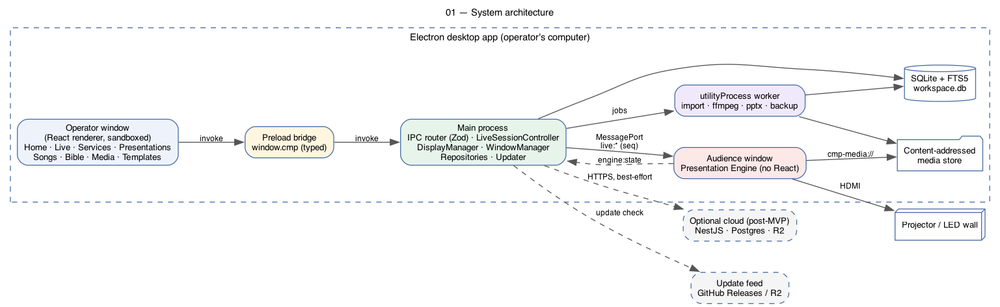 · [dot](01-system-architecture.dot)                 |
| Electron process & IPC boundary            | 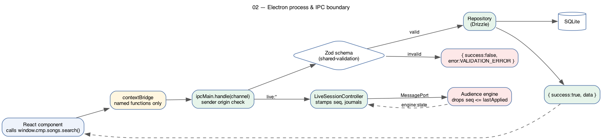 · [dot](02-process-ipc-boundary.dot)               |
| Live session state machine                 | 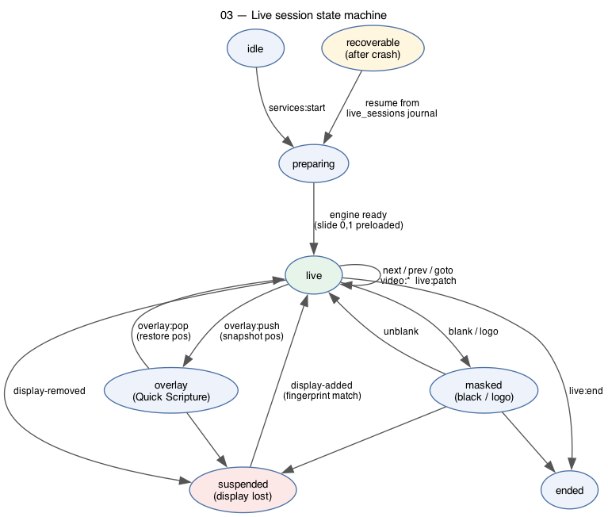 · [dot](03-live-presentation-lifecycle.dot) |
| Display management & hot-plug recovery     | 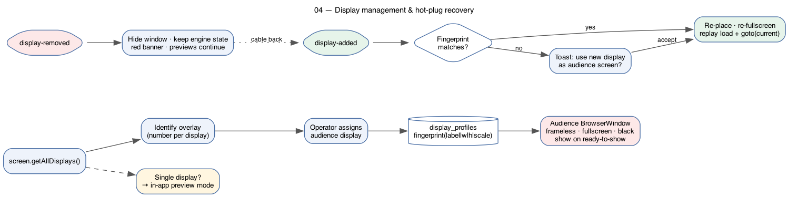 · [dot](04-display-management.dot)                   |
| Lyrics-to-slides pipeline                  | 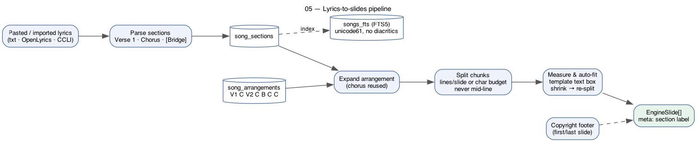 · [dot](05-lyrics-to-slides.dot)                       |
| Bible lookup & Quick Scripture             | 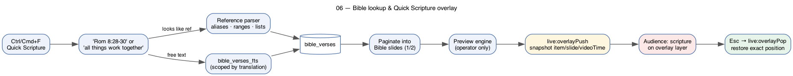 · [dot](06-quick-scripture.dot)                         |
| Media import pipeline                      | 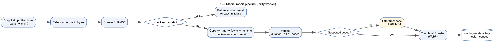 · [dot](07-media-import.dot)                               |
| Service planning & resolution              | 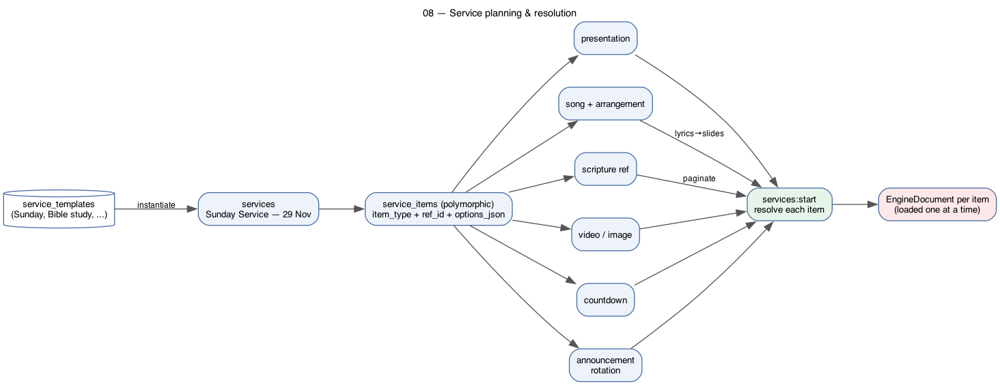 · [dot](08-service-planner.dot)                         |
| Backup & crash recovery                    | 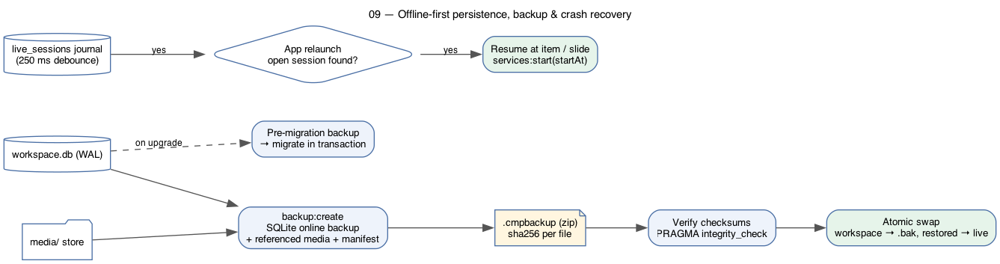 · [dot](09-backup-recovery.dot)                         |
| Content catalogue & media packs (post-MVP) | 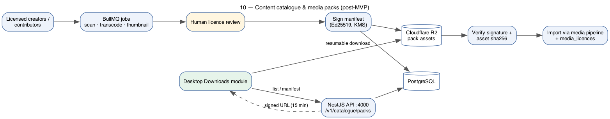 · [dot](10-content-catalogue.dot)                     |
| Data model                                 | 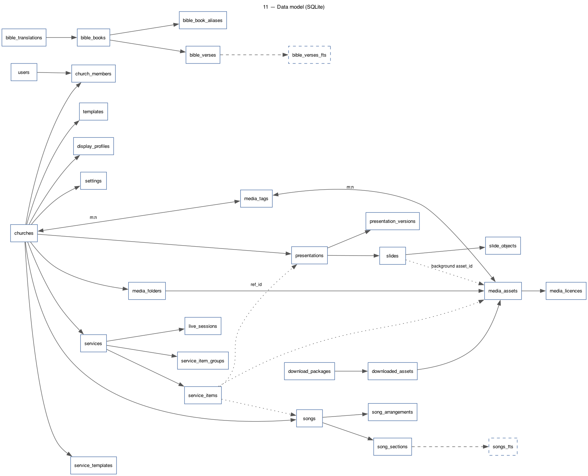 · [dot](11-data-model.dot)                                   |
| Release & distribution                     | 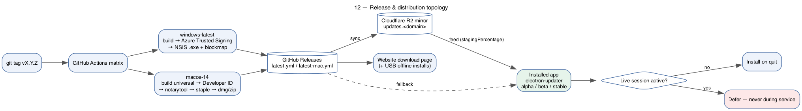 · [dot](12-release-distribution.dot)               |

Regenerate: `../render.sh`
